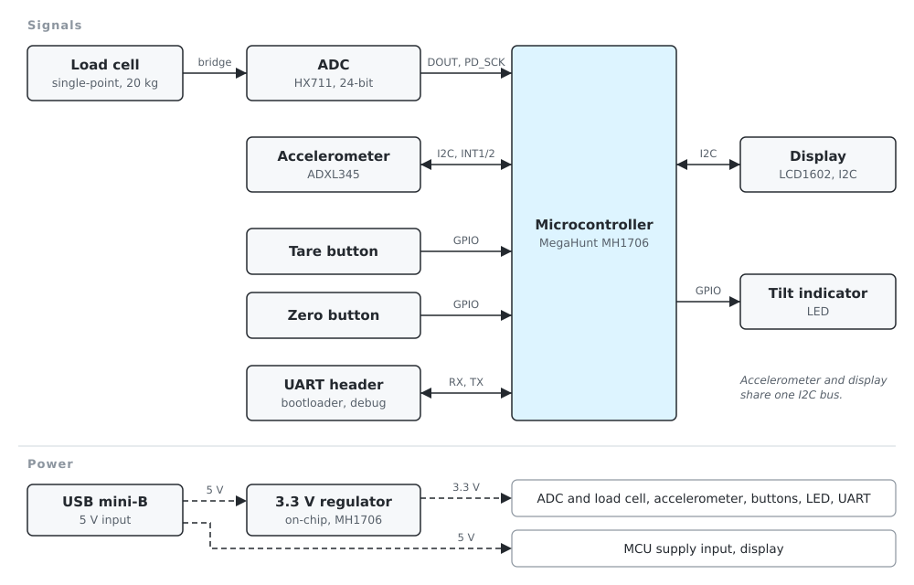
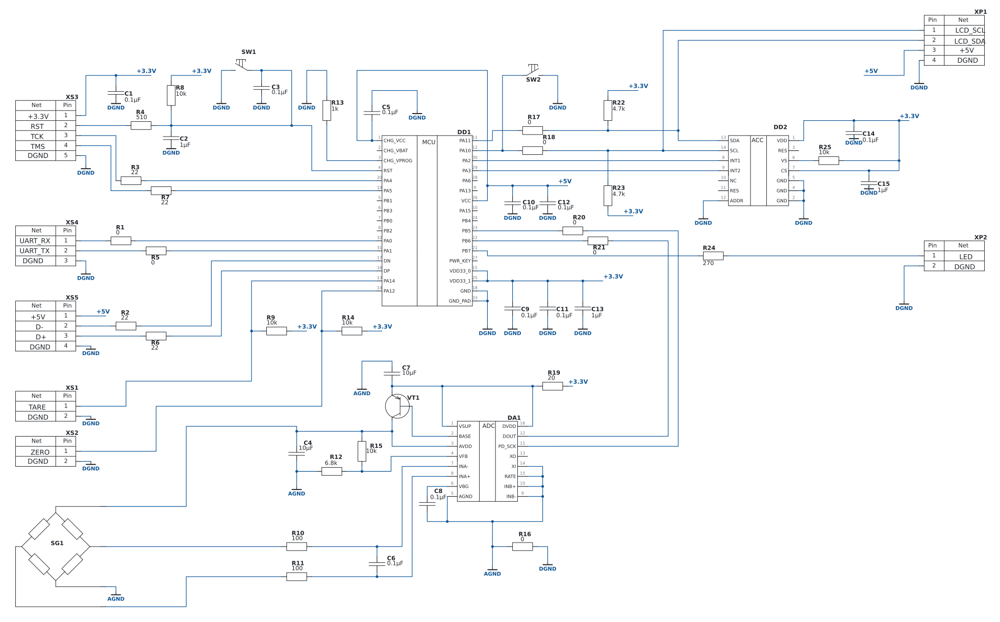

# Hardware

## Block diagram

The original drawing to GOST 2.701-2008 (sheet E1, in Russian) is in
[drawings/E1-block-diagram.pdf](drawings/E1-block-diagram.pdf).

## Functional blocks

Mass is measured by three blocks: the load cell, the ADC and the microcontroller. The
accelerometer, the microcontroller and the tilt indicator form the leveling function. The
display shows the result, and two buttons control the tare.

| Block          | Component                         | Function                                                                  |
|----------------|-----------------------------------|---------------------------------------------------------------------------|
| Load cell      | Keli AM1, single-point, 20 kg      | Converts the load into a millivolt bridge signal                         |
| ADC            | HX711                             | Amplifies the bridge signal (PGA ×128) and converts it at 24-bit resolution; powers the bridge |
| Accelerometer  | ADXL345                           | Measures the gravity vector on three axes to find the tilt of the scale   |
| Microcontroller| MegaHunt MH1706                   | Reads the sensors, filters the data, computes mass and tilt, drives the display and the indicator |
| Display        | LCD1602 with I2C adapter          | Shows the mass and the status of the scale                                |
| Tilt indicator | LED                               | Warns the operator that the scale is not level                            |
| Tare button    | Panel push button                 | Adds the current load to the tare                                         |
| Zero button    | Panel push button                 | Clears the tare and returns to the calibrated zero                        |
| UART header    | Pin header                        | Firmware upload through the bootloader, debug output                      |

## Interfaces

| Link                        | Interface                         |
|-----------------------------|-----------------------------------|
| Load cell → ADC             | Differential bridge signal, filtered by an RC network |
| ADC → MCU                   | Two-wire serial (DOUT, PD_SCK)    |
| Accelerometer ↔ MCU         | I2C, interrupt lines INT1 and INT2 |
| MCU ↔ display               | I2C, shared with the accelerometer |
| MCU → tilt indicator        | GPIO                              |
| Buttons → MCU               | GPIO with pull-up resistors       |
| UART header ↔ MCU           | UART (RX, TX)                     |

## Power

The board is powered with 5 V through the USB mini-B connector. The MH1706 has an on-chip
regulator that supplies the 3.3 V rail for the ADC and the load cell, the accelerometer, the
buttons, the indicator and the UART. The display runs from 5 V.

## Schematic

The image is rendered from the Altium Designer project with English labels. The original
drawing to GOST 2.702-2011 (sheet E3, in Russian) is in
[drawings/E3-schematic.pdf](drawings/E3-schematic.pdf).

## Bill of materials

The board carries 54 parts, listed in [bom.csv](bom.csv) with manufacturer part numbers.
The original parts list (PE3) is in [drawings/PE3-parts-list.pdf](drawings/PE3-parts-list.pdf).
It is kept as submitted with the thesis; where the two differ, bom.csv is correct: it follows
the manufacturer part numbers and the assembled prototype.

The load cell, the display, the tilt LED and the two buttons are mounted in the enclosure and
connect to the board through XS1, XS2, XP1, XP2 and the SG1 pads.

## MCU pin assignment

| Pin    | Name              | Function                          | Connection                         |
|--------|-------------------|-----------------------------------|------------------------------------|
| 1, 26  | CHG_VCC, VCC      | 5 V supply input                  | +5V from XS5 (USB)                 |
| 15, 25 | VDD33_0, VDD33_1  | On-chip regulator output          | +3.3V rail                         |
| 18, 33 | GND, GND_PAD      | Ground                            | DGND                               |
| 3      | CHG_VPROG         | —                                 | R13 (1 kΩ) to DGND                 |
| 4      | RST               | Reset, active low                 | R8 pull-up, C2, SW1, XS3.2 via R4  |
| 20     | PA4               | SWD clock                         | XS3.3 (TCK) via R3                 |
| 19     | PA5               | SWD data                          | XS3.4 (TMS) via R7                 |
| 32     | PA0               | UART                              | XS4.1 (UART_RX) via R1             |
| 31     | PA1               | UART                              | XS4.2 (UART_TX) via R5             |
| 17     | DN                | USB D−                            | XS5.2 via R2                       |
| 16     | DP                | USB D+                            | XS5.3 via R6                       |
| 11     | PA11              | I2C SDA                           | DD2 SDA, XP1.2 via R17             |
| 12     | PA10              | I2C SCL, boot mode                | DD2 SCL, XP1.1 via R18; SW2 to DGND |
| 30     | PA2               | Accelerometer interrupt 1         | DD2 INT1                           |
| 29     | PA3               | Accelerometer interrupt 2         | DD2 INT2                           |
| 23     | PB5               | ADC clock                         | DA1 PD_SCK via R20                 |
| 22     | PB6               | ADC data                          | DA1 DOUT via R21                   |
| 21     | PB7               | Tilt LED                          | XP2.1 via R24 (270 Ω)              |
| 13     | PA14              | Tare button, active low           | XS1.1, R9 pull-up                  |
| 14     | PA12              | Zero button, active low           | XS2.1, R14 pull-up                 |

Not connected: PA6, PA13, PA15, PB0–PB4, CHG_VBAT, PWR_KEY.

## Circuit notes

**Power.** 5 V from the USB connector feeds the MCU (CHG_VCC, VCC) and the display. The
on-chip regulator of the MH1706 outputs 3.3 V on VDD33 for the rest of the board.

**ADC.** The HX711 is supplied from 3.3 V through an RC filter, R19 (20 Ω) and C7 (10 µF).
Its on-chip regulator with the external PNP transistor VT1 powers the bridge; the divider
R15/R12 sets the excitation to 1.25 V × (10 kΩ + 6.8 kΩ) / 6.8 kΩ ≈ 3.1 V. The bridge
output passes a differential RC filter, R10, R11 (100 Ω) and C6 (100 nF), with a cut-off
near 8 kHz. Channel B is not used (INB± tied to AGND), RATE is tied low for 10 samples
per second, and XI is tied low to run the on-chip oscillator.

**Grounds.** Analog (AGND) and digital (DGND) grounds join at one point through R16 (0 Ω).

**I2C.** PA11 (SDA) and PA10 (SCL) drive one bus shared by the ADXL345 and the display, with
4.7 kΩ pull-ups R22, R23 to 3.3 V. The ADXL345 runs in I2C mode (CS tied high) at address
0x53 (ADDR tied low). The 0 Ω resistors R17, R18 let the MCU be disconnected from the bus
for debugging.

**Reset and boot.** RST has a 10 kΩ pull-up (R8), a 1 µF capacitor (C2) and the reset
button SW1. The jumper SW2 ties PA10 to ground to start the UART bootloader; remove it for
normal operation, because PA10 is also the I2C clock.

**Series resistors.** 22 Ω resistors on the SWD and USB lines damp ringing; 0 Ω resistors on
UART and ADC lines leave room for rework.
